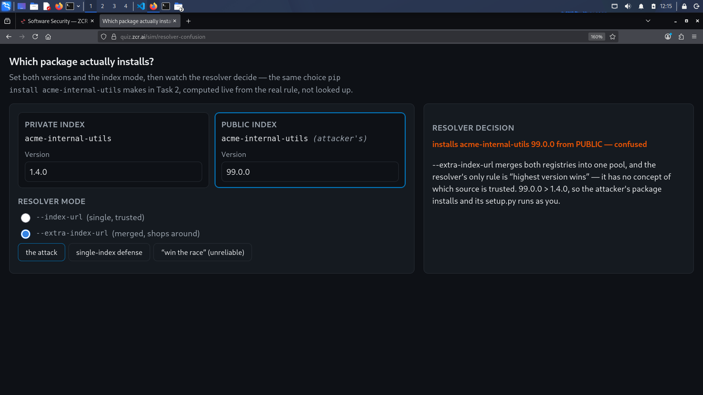
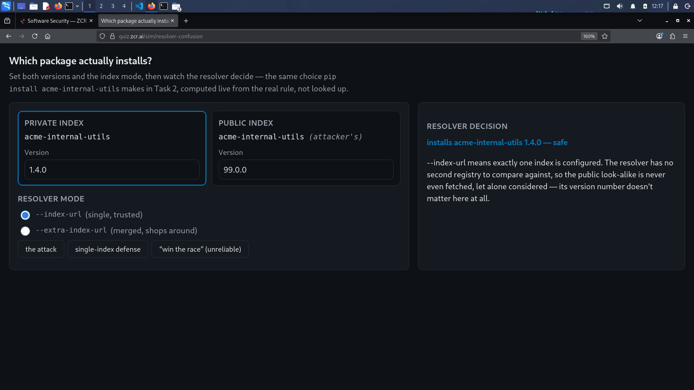
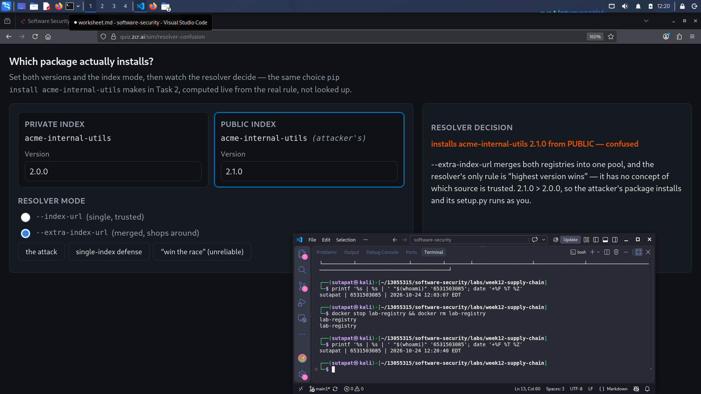
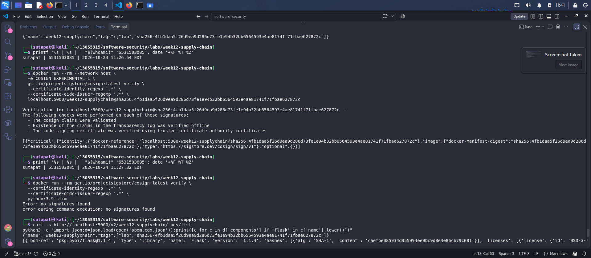
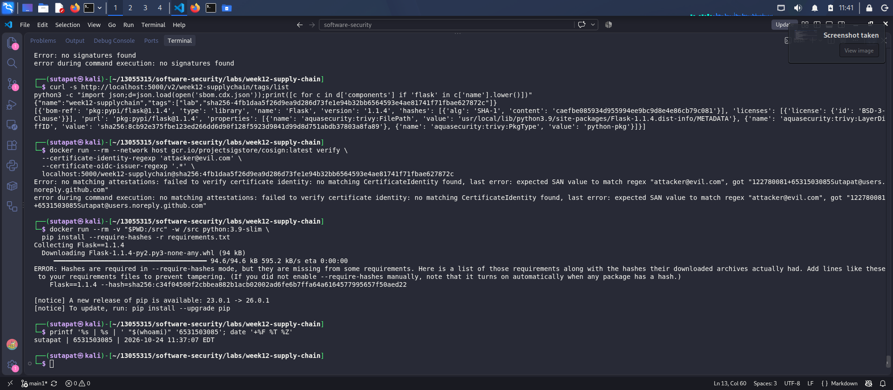

# Worksheet 12 — Software Supply-Chain Security (3 hrs)

> **Course:** Software Security (KOSEN69) · Week 12
> **Aligned:** OWASP 2025 — A03 Software Supply Chain Failures · A08 Software or Data Integrity Failures · **CWE:** CWE-1104, CWE-829, CWE-1357, CWE-1395
> **Signature game:** 📦 Dependency Confusion Heist
>
> **Ethics note:** This lab has **no live private/public registry to attack** — the dependency-confusion exercise is a controlled walkthrough (`dependency-confusion.md`) plus the interactive resolver simulation in Task 2, not a real package pull. **Never** plant or publish look-alike packages on the real PyPI or npm — that is an attack on every downstream user, and nothing in this lab requires it.

## Part 1 — Student Information

| Name | Student ID | Date | Group |
|------|-----------|------|-------|
|   Sutapat Chucham   |      6531503085     |   24 Oct 2026   |       |

## Part 2 — Lecture Questions

1. Explain **dependency confusion** (substitution). Why does a public `acme-internal-utils==99.0.0` win over a private `==1.4.0` when a resolver shops both indexes?
**Ans:** Dependency confusion is when the attacker upload a package to the public registry with the same name as our internal package but a higher version, so our build install the attacker one (CWE-1357). With `--extra-index-url` pip put the candidates from every index into one pool and pick the highest version, it has no idea which index belong to our company. So 99.0.0 beat 1.4.0. pip is not broken, it follow its rule correctly, the problem is our config let one resolver see two different index at the same time. In the simulation I got
`installs acme-internal-utils 99.0.0 from PUBLIC - confused`.
2. How does **typosquatting** (`reqeusts`, `urlib3`) achieve code execution *at install time* before any of your code runs?
**Ans:** When pip gets a **sdist** (`.tar.gz`) it must build it first, and build means it run `setup.py`, which is standard Python code and executed with the permission of the user who type install with pip (in CI that is the runner with all the tokens). So one error is enough, attacker code is already running before our own code is imported (CWE-829) One detail: a **wheel** does not run code upon install, pip just unpack it, therefore the execution comes from sdist. That is why `--only-binary :all:` is useful, too.
3. What is an **SBOM** (CycloneDX/SPDX) and why is it a prerequisite for both incident response and SLSA provenance?
**Ans:** SBOM provides a machine-readable list of CycloneDX or SPDX components, including name, version, `purl}, license, and hash. In incident response, the first question is "do we have it and which version" for CVEs like Log4Shell. SBOM involves grepping the file instead than rebuilding all services. The `purl` parameter is crucial as it is a standard identifier that tools can match with the advisory database. The SLSA provenance must specify the materials used, so it cannot be written without listing the contents.
4. Sigstore **keyless** signing uses Fulcio (CA) + Rekor (transparency log) tied to an OIDC identity. Why is that safer than a long-lived private key (CWE-321)?
**Ans:** The key pair is constructed in memory for one signing (the terminal displays "Generating ephemeral keys..."). After logging in with OIDC, Fulcio issue a certificate lasting 10 minutes, and the signature is added to Rekor, a public append-only log. Safer: No key file to steal (CWE-321), 10-minute window instead of years, attackers must obtain MFA accounts, and signature is attached to a verified identity (e.g., `122780081+6531503085Sutapat@users.noreply.github.com`). Rekor allows owners to view if someone signs in their name. The drawback is that identities are permanently recorded and rely on Fulcio, Rekor, and the OIDC provider.
5. Summarize the **SLSA** levels. Which level does "signed artifact + SBOM + provenance gate before deploy" put you at, and what is still missing?
**Ans:**
SLSA v1.0 Build track has 4 levels:

- **L0** - nothing.
- **L1** - provenance exist, but anybody can write it so it can be faked.
- **L2** - provenance is generated and signed by a hosted build service.
- **L3** - the build run on a hardened isolated builder, so even the build steps cannot fake it.
The "Signed artifact + SBOM + provenance gate" is L1-L2, but only L2 if the provenance comes from a build service. Since I signed by hand from my own machine and SBOM does not indicate provenance, my lab only reached **L1**. Therefore, I did not create a provenance document. To advance, I require provenance linked to a source commit, signed by a hosted builder (L2), an isolated build environment (L3), and a gate with a specific identity instead of `.*`.


## Part 3 — Hands-on Lab (150 min)

**Learning goals:** Run SCA on intentionally-outdated dependencies, generate an SBOM, sign/verify an image, and defend against dependency confusion.

**Prerequisites:** Docker; the lab folder (`requirements.txt`, `Dockerfile`, `app.py`, `sca_scan.sh`, `sign.sh`). For signing: browser for the OIDC flow + registry push access.

**Environment setup**
```bash
cd labs/week12-supply-chain
bash sca_scan.sh                 # trivy fs + pip-audit on requirements.txt (+ optional image scan)
docker build -t week12-supplychain:lab .
bash sign.sh week12-supplychain:lab   # CycloneDX SBOM -> sbom.cdx.json, then cosign sign + verify
```

**What to submit per task:** the exact command(s) + output, a screenshot, and a 2–3 sentence remediation note mapping the finding to A03/A08 or the CWE.

### Task 0 — Onboarding (15 min)
Read `requirements.txt` and list the pinned packages with their versions. Note why they are intentionally outdated (each is deliberately an old release so SCA tools flag its known CVEs).
**Deliverable:** the package/version table + which OWASP/CWE this maps to.
**The Package/Version Table**
| Package | Pinned version | Note from the file |
|---|---|---|
| Flask | 1.1.4 | old Flask 1.x |
| Werkzeug | 1.0.1 | before the 2.x hardening |
| Jinja2 | 2.11.3 | comment say CVE-2020-28493 |
| MarkupSafe | 2.0.1 | pinned for Jinja2 2.11 |
| itsdangerous | 1.1.0 | pinned for Flask 1.1.x |
| click | 7.1.2 | pinned for Flask 1.1.x |
| requests | 2.25.1 | old HTTP client |
| urllib3 | 1.26.4 | CVE-2021-33503 |
| PyYAML | 5.4.1 | old release |

**Mapping:**

- **A03:2025** - we ship third party code that have known vulnerability.
- **CWE-1395** - component that have a known bug but still maintained, so we can fix by bump the
  version (Flask, Werkzeug, urllib3, requests, Jinja2).
- **CWE-1104** - component that nobody maintain anymore, bump is not possible so we must replace
  it. Here it is the base image `python:3.9-slim`, because Python 3.9 is already end of life.

### Task 1 — SCA scan: build the remediation worklist (35 min)
**Goal:** Flag the known-vulnerable dependencies — A03.
**Steps:**
1. `bash sca_scan.sh` — read the `trivy fs` table (CVE, installed vs. fixed version) and the `pip-audit` advisory IDs (GHSA-/PYSEC-).
2. Pick three findings; record CVE/advisory id, severity, and the fixed version.
**Deliverable:** the SCA output + a 3-row remediation table (package → current → fixed).
| Scan | Result | Scope |
|---|---|---|
| `trivy fs` from `sca_scan.sh` | `Total: 11 (HIGH: 11, CRITICAL: 0)` | only `requirements.txt`, filter `HIGH,CRITICAL` |
| `trivy fs` without filter | `Total: 29 (LOW: 2, MEDIUM: 16, HIGH: 11, CRITICAL: 0)` | same file, all severity |
| `pip-audit` | 33 vulnerabilities in 6 packages | resolved dependency tree |
| `trivy image` | `Total: 125 (HIGH: 119, CRITICAL: 6)` | Python packages + debian 13.1 OS packages |

**Remediation table (3 findings from 3 different layer)**

| # | Package | Current | Fixed | CVE / Advisory | Severity | Come from | Layer |
|---|---|---|---|---|---|---|---|
| 1 | urllib3 | 1.26.4 | 1.26.5 | CVE-2021-33503 | HIGH | `requirements.txt` | direct |
| 2 | idna | 2.10 | 3.7 | PYSEC-2024-60 | - | not in `requirements.txt`, come from `requests` | transitive |
| 3 | libssl3t64 | 3.5.1-1+deb13u1 | 3.5.5-1~deb13u2 | CVE-2026-31789 | CRITICAL | base image `python:3.9-slim` | base image / OS |


### Task 2 — Dependency Confusion Heist (35 min)
**Goal:** Watch the wrong package win — A03 / CWE-1357.

**Reality check:** this lab does **not** stand up a live private/public registry. `acme-internal-utils` is
a worked example, not an installable package — there is nothing to actually `pip install` here (the name
doesn't exist on real PyPI either, so don't expect that to work as a shortcut). Task 2 is a controlled
walkthrough of the resolver's own rule, using the simulation below, which computes the real
"highest version wins" logic live instead of just asserting the outcome.

```sim
resolver-confusion
```

**Steps:**
1. Read `dependency-confusion.md`'s "Dependency confusion (substitution)" section for the mechanism.
2. In the simulation, load the **"the attack"** preset (private `1.4.0`, public `99.0.0`, merged /
   `--extra-index-url` mode) and record which index the resolver picks and why.
3. Keep the same version numbers and switch to the **single-index** (`--index-url`) mode; record how the
   verdict changes — this is the resolver behavior Task 4's "single trusted index" defense relies on.
4. Try the **"win the race"** preset (private version numerically higher than public) and note why the
   sim's own explanation calls that "not a defense."

**Deliverable:** a screenshot of the simulation's verdict in both index modes (merged vs. single) for the
same version pair, plus one sentence on why an attacker defeats the "keep my internal version number high"
idea.

There is no live registry in this lab and `acme-internal-utils` does not exist on real PyPI
either, so I use the simulation.

| Step | Private | Public | Mode | Decision |
|---|---|---|---|---|
| 1 | 1.4.0 | 99.0.0 | `--extra-index-url` | **installs 99.0.0 from PUBLIC - confused** |
| 2 | 1.4.0 | 99.0.0 | `--index-url` | **installs 1.4.0 - safe** |
| 3 | 2.0.0 | 1.9.0 | merged | **installs 2.0.0 from PRIVATE - safe this time** |
| 4 | 2.0.0 | **2.1.0** | merged | **installs 2.1.0 from PUBLIC - confused** |





Step 1 and 2 use the same two version numbers, only the mode is different. The simulation say for
single index: *"the public look-alike is never even fetched, let alone considered - its version
number doesn't matter here at all."* That is the interesting part for me, in step 2 the attacker
99.0.0 is still sitting there, nothing beat it, nobody ask it.



**Why the attacker beat the "keep our version number high" idea:** the attacker choose their own
version number, so this is a race we can only lead for a short time - I set private to 2.0.0 and
it won against 1.9.0, then I change the public one to 2.1.0 and it go back to confused
immediately, so the real fix must hide the attacker package from the resolver (single index or
internal proxy) or pin the file by hash.

### Task 3 — SBOM + signing/verification (30 min)
**Goal:** Produce a component inventory and prove integrity — A08.
**Steps:**
1. After `bash sign.sh week12-supplychain:lab`, open `sbom.cdx.json` and find Flask's entry.
2. Read the `cosign verify` PASS for the signed image.
3. Negative test on an unsigned image (it **must** fail):
   `cosign verify --certificate-identity-regexp '.*' --certificate-oidc-issuer-regexp '.*' python:3.9-slim`
   → `Error: no signatures found`. (Both `--certificate-identity*` flags are required in keyless mode; without
   them cosign stops at `Error: --certificate-identity or --certificate-identity-regexp is required` — a usage
   error, which is *not* the same thing as proving the image is unsigned.)
**Deliverable:** the SBOM Flask component entry + the verify PASS + the negative-test failure.
`sign.sh` fail first with `UNAUTHORIZED` because cosign work with a registry and not with the
local docker daemon, and the signature also need a place to be stored. So I push the image to my
own registry and sign it by digest.

```bash
docker run -d -p 5000:5000 --name lab-registry registry:2
docker tag week12-supplychain:lab localhost:5000/week12-supplychain:lab
docker push localhost:5000/week12-supplychain:lab
# lab: digest: sha256:4fb1daa5f26d9ea9d286d73fe1e94b32bb6564593e4ae81741f71fbae627872c

docker run --rm -it --network host -e COSIGN_EXPERIMENTAL=1 \
  gcr.io/projectsigstore/cosign:latest sign --yes \
  localhost:5000/week12-supplychain@sha256:4fb1daa5...872c
```

**1) SBOM Flask component entry**

```json
{
  "bom-ref": "pkg:pypi/flask@1.1.4",
  "name": "Flask", "version": "1.1.4",
  "hashes": [{"alg": "SHA-1", "content": "caefbe085934d955994ee9bc9d8e4e86cb79c081"}],
  "licenses": [{"license": {"id": "BSD-3-Clause"}}],
  "purl": "pkg:pypi/flask@1.1.4",
  "properties": [
    {"name": "aquasecurity:trivy:FilePath", "value": "usr/local/lib/python3.9/site-packages/Flask-1.1.4.dist-info/METADATA"},
    {"name": "aquasecurity:trivy:LayerDiffID", "value": "sha256:8cb92e375fbe123ed266dd6d90f128f5923d9841d99d8d751abdb37803a8fa89"}
  ]
}
```

**2) verify PASS**

```
Verification for localhost:5000/week12-supplychain@sha256:4fb1daa5...872c --
  - The cosign claims were validated
  - Existence of the claims in the transparency log was verified offline
  - The code-signing certificate was verified using trusted certificate authority certificates
```

**3) negative test - unsigned image must fail**

```bash
docker run --rm gcr.io/projectsigstore/cosign:latest verify \
  --certificate-identity-regexp '.*' --certificate-oidc-issuer-regexp '.*' python:3.9-slim
# Error: no signatures found
```





Extra test I did by myself: verifying the **same** image with
`--certificate-identity-regexp 'attacker@evil.com'` also fail, with
`got "122780081+6531503085Sutapat@users.noreply.github.com"`. So a signature answer two question,
not one: was the artifact changed, and who sign it.

**Remediation note.** SBOM give the inventory and `purl` is the field that can be matched with an
advisory database, keyless signing give integrity bound to an identity without a long-lived key
on disk (CWE-321), and Rekor give a public log. Together this cover A08:2025. The
`no signatures found` error is also not the same as the usage error we get when the two
`--certificate-identity*` flags are missing, that one prove nothing about the image.

### Task 4 — Defend / fix it (35 min)
**Goal:** Stop dependency confusion and lock integrity — defenses from `dependency-confusion.md` + `sign.sh`.
**Steps:**
1. **Pin + hashes:** run `pip install --require-hashes -r requirements.txt` against this lab's own
   `requirements.txt` (it has no hashes yet) and record pip's refusal — `ERROR: Hashes are required in
   --require-hashes mode...` plus the `--hash=sha256:…` line pip prints for you. That refusal is the same
   mechanism that would block a real confusion substitution: once hashes are required, a package that
   doesn't match — from *either* index — cannot install silently.
2. **Single trusted index:** use one `--index-url` instead of `--extra-index-url`; explain why the resolver stops shopping around (tie this back to Task 2's single-index verdict).
3. **Namespace scoping:** describe reserving/namespacing the internal package name.
4. **Provenance gate:** state how the `cosign verify` from `sign.sh` becomes a gate before a simulated deploy.
**Deliverable:** the `--require-hashes` refusal output (step 1) + the simulation's before/after verdict for merged vs. single index (from Task 2) + the one defense you found most effective and why.
**1) pin + hashes**

```bash
docker run --rm -v "$PWD:/src" -w /src python:3.9-slim pip install --require-hashes -r requirements.txt
```
```
ERROR: Hashes are required in --require-hashes mode, but they are missing from some
requirements. ... Add lines like these to your requirements files to prevent tampering.
    Flask==1.1.4 --hash=sha256:c34f04500f2cbbea882b1acb02002ad6fe6b7ffa64a6164577995657f50aed22
```

pip refuse even though every package is already pinned with `==`. `==1.1.4` pin the label,
`--hash=sha256:...` pin the bytes, same idea as docker tag and digest.

**2) single trusted index**

```bash
pip install -r requirements.txt --extra-index-url https://pypi.org/simple              # risky
pip install -r requirements.txt --index-url https://internal-proxy.acme.local/simple   # safer
```

`--extra-index-url` add one more source into the pool that pip compare, `--index-url` replace it
so only one index is ever asked. This is the same behaviour as the Task 2 verdict.

**3) namespace scoping.** npm have real scope (`@acme/utils`) but PyPI does not have namespace, so
we register our internal name on public PyPI as an empty placeholder, use a consistent prefix, and
still keep the index pinning. Scoping stop the attacker from owning the name, index pinning stop
the resolver from seeing it.

**4) provenance gate**

```bash
set -euo pipefail
cosign verify \
  --certificate-identity-regexp '^122780081\+6531503085Sutapat@users\.noreply\.github\.com$' \
  --certificate-oidc-issuer 'https://github.com/login/oauth' \
  "localhost:5000/week12-supplychain@sha256:4fb1daa5...872c"
echo "gate passed - deploying"
```

`cosign verify` exit non-zero when it fail so with `set -e` the pipeline stop before deploy, the
identity and issuer are exact value instead of `.*`, and it use the digest so we deploy the same
thing we verified.

## Part 4 — Reflection

1. **Mapping:** table — finding | tool (`sca_scan.sh` / `sign.sh`) | OWASP 2025 id | CWE | fix.
| Finding | Tool | OWASP | CWE | Fix |
|---|---|---|---|---|
| urllib3 1.26.4, CVE-2021-33503 | trivy fs | A03 | 1395 | bump to 1.26.5+ |
| idna 2.10 (transitive) | pip-audit | A03 | 1395 | bump `requests`, lock the tree |
| libssl3t64 CVE-2026-31789 | trivy image | A03 | 1395 | change base image |
| `python:3.9-slim` is EOL | trivy image | A03 | **1104** | move to supported Python |
| no hashes in `requirements.txt` | `pip --require-hashes` | A03 / A08 | 1357 | lockfile with `--hash=sha256:` |
| resolver can see two index | simulation | A03 | **1357** | single `--index-url` + proxy |
| unknown content of the image | trivy SBOM | **A08** | - | SBOM every release |
| unsigned image can be deployed | cosign | **A08** | - | sign + verify gate with pinned identity |
2. **Real breach:** analyze the **XZ Utils backdoor (CVE-2024-3094)**. Which OWASP/CWE applies, and would an SBOM + signing + provenance gate have caught a maliciously-modified upstream dependency? (Compare with SolarWinds or Log4Shell if useful.)

A contributor using the name "Jia Tan" spend about 2 years contributing to `xz` until they become
a maintainer, then put a backdoor into **liblzma** in version **5.6.0 and 5.6.1**, targeting
`sshd` on distro where sshd is linked with systemd. It was found by Andres Freund who notice sshd
use too much CPU, not by any supply chain tool. Mapping: A03:2025 and A08:2025, CWE-506 embedded
malicious code.

| Control | Catch it? | Why |
|---|---|---|
| SBOM | No for prevention, useful after | 5.6.0 had no advisory yet, but on the news day SBOM answer which service use it |
| Signing | No | The signature say "the real maintainer released this", and that was true, so verify PASS |
| SLSA provenance | Have a chance | The payload was in the release tarball but **not in the git repository**, so building from the source commit would give a different artifact |

So SBOM and signature would not stop XZ. Signing protect against someone swapping the artifact in
the middle, it does not protect when the source itself is the attacker. Compare with Log4Shell,
which was an accidental bug where SBOM + SCA is the right answer, and SolarWinds, where the build
system was compromised and SLSA L3 is designed for that. These are three different failure mode:
a vulnerability, a build compromise, and a trust compromise.

3. **Best mitigation + SLSA self-assessment:** one paragraph — which SLSA level your defenses reach and why, and the single highest-leverage control for your team.
Our setup approximates **SLSA Build L1**. We use a Dockerfile to build, publish a CycloneDX SBOM, then sign and verify the image before a simulated deployment. The artifact is not L2 since the provenance is manually signed and not generated by a hosted build service. Additionally, the SBOM simply lists ingredients and does not provide information on how the item was built. For L3, a hardened, isolated builder is necessary to prevent bogus build stages. I recommend a single trusted index through an internal proxy registry for a team in this circumstance. This eliminates dependency confusion and works for all packages in the tree without maintenance. Hash pinned lockfiles are stronger per package but only fail during installation and require regeneration upon bumps. The gate should utilize a pinned identity, not `.*`, as my test proved that `.*` merely proves signature.

## Grading rubric (100)

| Criterion | Weight |
|-----------|--------|
| Lecture questions (Part 2) | 20 |
| Exploitation + evidence (Tasks 1–3: SCA findings, confusion proof, SBOM/verify) | 40 |
| Defense (Task 4: pinning/hashes, single index, scoping, provenance gate) | 25 |
| Reflection (Part 4: mapping, XZ breach, SLSA self-assessment) | 15 |
| **Total** | **100** |

---

## Evidence & Integrity (required)

- **Identity proof:** every screenshot/diagram must show a terminal running `printf '%s | %s | ' "$(whoami)" '<YOUR-STUDENT-ID>'; date '+%F %T %Z'` **in the
  same image as the evidence**. When the evidence is a browser page, a DevTools panel or a
  rendered response, put that terminal **beside the browser and capture the whole screen** — a
  cropped window carries nothing that identifies you, and the lab's own output is
  byte-identical for the whole cohort *by design*, so the stamp is the only thing that makes
  the shot yours. Generic or borrowed evidence is not accepted.
- **Personalized flag (if this lab issues one):** ____________________
  *Flags are unique per student — submitting another student's flag is a violation. How to submit: **learn.zcr.ai/submit** (full guide: `SUBMISSION.md` in the repo root).*
- **Explain in your own words** *(graded on your reasoning, not copied text):*
  1. What did you do, and **why did the vulnerability work**?
  **Ans:** I do three scans to identify obsolete dependencies, build an SBOM, sign the image using Sigstore keyless through a local registry, validate it, and demonstrate two verification failures. Application of defenses follows. The vulnerability exists when code is trusted but not verified. Since the resolver only has a version number to break ties, allowing pip to look at two indexes simultaneously gives the decision to the larger number published by the attacker. Installing sdist and running its build script as the user allows attacker code to execute before ours.
  2. **Why does your fix actually stop it** — and what could still break it?
  **Ans:** A single `--index-url` prevents the attacker package from being downloaded, therefore its version is irrelevant. The installed file must match the checked bytes with hashes. A gate with a pinned identity prevents generation of an image that is not trusted. What may break it?
  In XZ, a trusted maintainer can ship bad code, a compromised proxy can serve bad packages, hashes are carelessly regenerated during upgrades, transitive dependencies are not protected (e.g., `idna 2.10`), and the gate is ineffective if `.*` is left or the GitHub account behind the identity is taken over.

---

## 🤖 Audit the AI (required)

AI is a power tool you must **distrust** — you are graded on your *critique*, not the AI's answer.

1. Ask an AI assistant to exploit **or** fix this week's vulnerability. Paste its full answer.
> *My Python service installs dependencies from a private index plus public PyPI, and a security
> review flagged dependency confusion and outdated packages. Give me a fix: how do I configure pip
> safely, and how do I make sure the container image I deploy hasn't been tampered with?*

> **1. Point pip at your private index** - `pip install -r requirements.txt --extra-index-url https://pypi.acme.local/simple`
>
> **2. Pin your versions** - Dependency confusion happens when an attacker publishes a higher
> version. Pinning exact versions in `requirements.txt` closes this: `Flask==1.1.4`,
> `urllib3==1.26.4`. Since the version is locked to `1.1.4`, pip cannot silently jump to the
> attacker's `99.0.0`.
>
> **3. Be careful with typos** - Any `pip install` executes the package's `setup.py`, so a single
> mistyped package name runs arbitrary code on your machine.
>
> **4. Patch the outdated packages** - `pip install --upgrade flask werkzeug jinja2 requests urllib3 pyyaml`
>
> **5. Generate an SBOM and sign the image** - `trivy image --format cyclonedx -o sbom.json myapp:latest`,
> `cosign sign myapp:latest`, `cosign verify --certificate-identity-regexp '.*' --certificate-oidc-issuer-regexp '.*' myapp:latest`.
> With an SBOM plus a signed image you have full provenance for the artifact, which puts you at
> SLSA Level 2 and satisfies A08.
2. **Find what's wrong or risky** in it — insecure code, a subtly incomplete fix, a hallucinated API/function/CVE, a missed edge case, or wrong reasoning. Quote the exact line(s).
**(a)** *"`--extra-index-url https://pypi.acme.local/simple`"* - this is not the fix, it is the
config that create the problem. In the simulation the merged mode **is** `--extra-index-url` and
it gives `installs 99.0.0 from PUBLIC - confused`, while `--index-url` with the same two versions
gives `installs 1.4.0 - safe`. Following this step make the system worse, not the same.

**(b)** *"Since the version is locked to `1.1.4`, pip cannot silently jump to the attacker's
`99.0.0`"* - half correct, but it is written like it close dependency confusion. The attacker can
publish the **same** version number, transitive dependency are not pinned at all (my `idna 2.10`
is not in `requirements.txt` but it was installed and flagged), and `pip --require-hashes` refused
my file even though everything was already pinned with `==`.

**(c)** *"Any `pip install` executes the package's `setup.py`"* - too strong. A wheel does not run
code at install, the execution come from sdist. This matter because it point to
`--only-binary :all:` which the answer never mention.

**(d)** *"`--certificate-identity-regexp '.*'`"* and *"`cosign sign myapp:latest`"* - `.*` accept
a signature from anybody, and the attacker can get a real Fulcio certificate with their own free
account, so the gate will pass. My test show the identity is the deciding field: the same image
with `attacker@evil.com` failed with `got "122780081+6531503085Sutapat@users.noreply.github.com"`.
And `:latest` is a tag, which cosign itself warn about, because a tag can be moved to another
image between verify and deploy.

**(e)** *"an SBOM plus a signed image ... puts you at SLSA Level 2"* - three different things.
SBOM say what is inside, signature say who vouch for it, provenance say which commit and which
builder. There is no provenance here at all, so it is not even L1.
3. Produce the **correct, verified** version yourself and explain in 2–3 sentences why the AI's output was insufficient.
```bash
pip install -r requirements.txt --index-url https://internal-proxy.acme.local/simple
pip install --only-binary :all: --require-hashes -r requirements.txt

set -euo pipefail
cosign verify \
  --certificate-identity-regexp '^122780081\+6531503085Sutapat@users\.noreply\.github\.com$' \
  --certificate-oidc-issuer 'https://github.com/login/oauth' \
  "localhost:5000/week12-supplychain@sha256:4fb1daa5...872c"
```

Verified with my three test: unsigned image gives `no signatures found`, wrong identity gives
`no matching CertificateIdentity found`, and my own signed image pass all three cosign checks.

**Why it was not enough.** The answer picked the correct tools but the **values** were wrong in
almost every step, and the values are what decide if the control block anything:
`--extra-index-url` instead of `--index-url`, version pins instead of hashes, `.*` instead of a
real identity, a tag instead of a digest. Someone following it would have a pipeline that look
secure and even produce an SBOM, but it still install the attacker package and still deploy an
image signed by anyone.

> Disclose your AI use in the Part 1 table. This task counts toward your **Defense + Reflection** score.

---

## 🧠 Comprehension & Prompt (required)

**A. Explain in Plain English (EiPE).** In 2–3 sentences, in your own words, describe what this week's vulnerable code/endpoint actually *does* and *why it is exploitable* — explain the mechanism, don't dump jargon.
Flask has two small endpoints, so this worksheet's vulnerable code is not a function with a flaw. The issue is in the `requirements.txt` and `Dockerfile`, which link outdated Flask, Werkzeug, and urllib3 to an outdated `python:3.9-slim` base image. This results in the image containing vulnerable code and unpatched OS libraries without any build checks. Exploitability stems from how packages are fetched: a resolver with multiple indexes installs the highest version number, and a source distribution runs the package build script as the user, allowing attacker code to run before our own code is imported.

**B. Prompt Problem.** Write a **single prompt** that makes an AI produce a *correct, secure* fix for one finding. Run it: does the exploit now fail? If not, refine the prompt and try again. Submit the **final prompt + the verified result**.
*Graded on the prompt's precision and your verification — this trains problem decomposition and AI literacy (Denny et al. 2024).*

> I deploy a container image from a registry and need a pre-deploy gate that blocks any image I
> did not personally sign with Sigstore keyless signing. Use cosign keyless verification with BOTH
> the certificate identity and the OIDC issuer pinned to exact values, do not use '.\*' for either
> and explain what '.\*' would fail to block. Operate on an image digest, not a tag, and say why a
> tag is unsafe here. The gate must exit non-zero and stop the pipeline on failure. Do not
> conflate the SBOM with SLSA provenance, and state which SLSA Build level this gate alone reaches.
> Then give me the exact commands to prove it works: one that must FAIL on an unsigned image, one
> that must FAIL on a signature from a non-matching identity, and one that must PASS on my own
> signed image.

**Verified result:** the gate pass all three test on my machine - `python:3.9-slim` gives
`no signatures found`, my image with `attacker@evil.com` gives `no matching CertificateIdentity
found`, and my image with the real identity pass. What I learn is that I had to constrain the
**values**, not only the tool, because the first prompt left every security parameter to the
default.
