# Worksheet 13 — Cloud & Container Security (4 hrs)

> **Course:** Software Security (KOSEN69) · Week 13
> **Aligned to:** OWASP 2025 **A02 Security Misconfiguration** · **CWE-732** (incorrect permission assignment), **CWE-16** (configuration), plus CWE-798, CWE-250, CWE-538, CWE-269, CWE-1104
> **Signature game:** 🔍 *Misconfig Hunt* (CloudGoat-style) — each misconfig you find **and** fix = a flag.

> ⚠️ **Ethics note:** All artifacts here are deliberately broken for teaching and are marked *"Sandbox/teaching only; for authorized lab use."* Scan, exploit, and harden **only** these lab files (or systems you own / are authorized to test). Never point Trivy or these techniques at third-party cloud accounts or images without written permission.

---

## Part 1 — Student Information

| Name | Student ID | Date | Group |
|------|-----------|------|-------|
|   Sutapat chucham   |     6531503085      |   7 Nov 2026   |       |


AI use disclosure: I used an AI assistant (Claude) as a tutor to explain concepts,
check my reasoning, and help me articulate my written answers. I ran every command,
captured every screenshot, and performed the analysis myself; the AI did not run the lab
for me. The Audit the AI section below critiques a deliberately flawed AI-generated fix.
---

## Part 2 — Lecture Questions

Answer in your own words (2–4 sentences each).

1. Explain the **shared-responsibility model**. In `harden.md` it says "the cloud provider secures *of* the cloud; you secure what you put *in* it." Give one concrete example of each side for an S3-backed app.
**Ans** Cloud providers secure "of" the cloud; you secure "in" it. AWS secures the S3 service, data-centre infrastructure, host OS/hypervisor, disk durability and replication, and global network for S3-backed apps. Customer-configured bucket privacy (Block Public Access + bucket policy), object encryption (SSE), and IAM policies that control read/write access are secured by the customer. Data leaks from a public bucket are the customer's issue, not AWS's. AWS kept S3 operating; you publicized it.
2. `iam-policy-insecure.json` uses `"Action": "*"` and `"Resource": "*"`. Describe **why this violates least privilege** and map it to CWE-732 vs CWE-269 — what is the difference between the two CWEs here?
**Ans** This gives complete admin on every activity on every resource yet the app only needs to read items from a single bucket prefix. Least privilege says grant minimum authorization on minimum resource, this grants max, therefore one spilled key equals total account takeover (large explosion radius).

Action: “*” CWE-269 (Improper Privilege Management): the identity is authorized to accomplish much more than what is needed for its role.
Resource: "*" WE-732 (Incorrect Permission Assignment for a Critical Resource): on how it can act on permissions are too broad across all resources instead of specific ARNs. These are two independent deficiencies (too many verbs, too many objects), so they are rated as two separate results.
3. The insecure Dockerfile bakes `ENV API_TOKEN=sk_live_...`. Explain how an attacker recovers that secret from a shipped image (name the `docker` commands) and why this is **CWE-798 / CWE-200**.
**Ans** This is CWE-798 (usage of hard-coded credentials) the secret is incorporated in the artifact and CWE-200 (exposure of sensitive information) it's readable by anyone with the image. Removing the ENV in a later layer does not help, because previous layers are still present in the history, therefore you need to rotate any key that was ever baked in (older pushed pictures still have it).
4. Why is `FROM python:latest` (CWE-1104/CWE-16) a security and reproducibility problem, and how does pinning to an `@sha256:` digest fix it?
**Ans** It points to another underlying image over time. So builds are not reproducible (today's build!= next week's), and you can silently pull an altered, newly-vulnerable, or tampered base and not notice; you can't audit exactly what's running. That’s CWE-1104 (usage of unmaintained/uncontrolled component version) / CWE-16 (configuration). Pinning to @sha256:<digest> is immutable: the digest is a content hash, thus you always get the exact same bytes repeatable and auditable, and the base can't change underneath you.
5. What does a **distroless** base image remove (relative to `python:3.11-slim`), and how does that shrink the attack surface for an RCE or container-escape attacker?
**Ans** A distroless image (e.g. gcr.io/distroless/python3) cuts off the shell (/bin/sh, bash), the package manager (apt/pip at runtime), coreutils, and practically all of the OS userland leaving only the language runtime + your app + its dependencies. For an RCE or container escape attacker, this means no shell to run, no package manager to install tools, and considerably fewer binaries/libraries to exploit or pivot through, and fewer packages equals fewer CVEs. Running as non-root (uid 65532) coupled with a successful exploit leaves very little to work with.

---

## Part 3 — Hands-on Lab (180 min)

**Learning goals:** find cloud/container misconfigurations with Trivy, map each to a CWE, and rebuild the IAM policy + Dockerfile to least privilege / hardened so the findings drop.

**Prerequisites:** Docker installed and running; the `week13-cloud-container/` lab folder; internet access to pull `aquasec/trivy:latest`.

### Environment setup (real commands)

```bash
cd labs/week13-cloud-container

# Option A — the provided wrapper (trivy config over the Dockerfiles; IAM JSON is reviewed manually, see Task 2):
bash scan.sh

# Option B — run Trivy directly (MEDIUM is in the filter on purpose: one of the
# three rules Task 1 asks you to cite is rated MEDIUM, and HIGH,CRITICAL hides it):
docker run --rm -v "$PWD:/src" aquasec/trivy:latest config --severity MEDIUM,HIGH,CRITICAL /src

# (Optional) build + CVE-scan the hardened image:
docker build -f Dockerfile.hardened -t week13-hardened:lab .
docker run --rm -v /var/run/docker.sock:/var/run/docker.sock aquasec/trivy:latest image --severity HIGH,CRITICAL week13-hardened:lab
```

**What to submit per task:** the command(s) you ran + the relevant output (finding count or the specific finding line), a screenshot of the Trivy/terminal result, and a 2–3 sentence mitigation explaining *why* the fix reduces risk (cite the CWE).


### Tasks

- **Task 0 — Onboarding (15 min).** Confirm Docker works (`docker version`), run `bash scan.sh`, and record the **baseline finding count** against `Dockerfile.insecure` (Trivy's `config` scanner does not parse standalone IAM policy JSON, so `iam-policy-insecure.json` is reviewed manually instead — see Task 2). **Deliverable:** screenshot of the baseline scan.

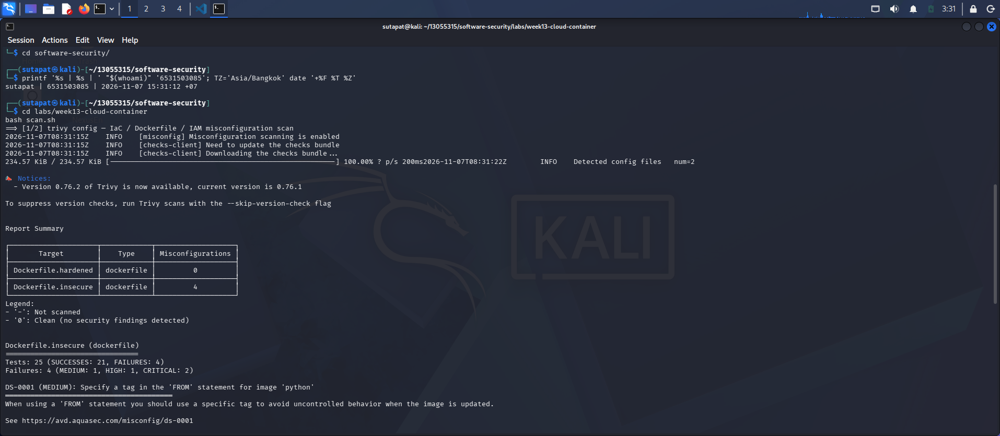
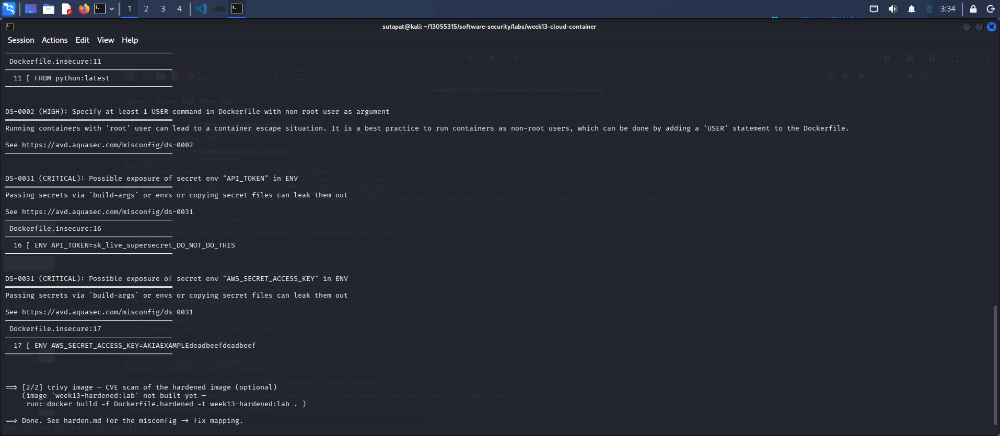


- **Task 1 — Misconfig Hunt: container image (40 min).** *Goal:* find every defect in `Dockerfile.insecure`. *Steps:* read each `# DEFECT:` comment, then locate the matching Trivy finding where one exists — only 3 of the 6 (unpinned `:latest`, runs as root, secrets in `ENV`) map to a Trivy config rule (`DS-0001`, `DS-0002`, `DS-0031`); `COPY . .`, `chmod -R 777`, and unpinned `pip install` are instruction-level RUN/COPY semantics Trivy's Dockerfile scanner doesn't check, so identify those 3 by code review instead. Build a table: defect → CWE → Trivy rule/severity (write "manual review — no Trivy rule" where none exists). *Deliverable:* completed table (6 rows) using the IDs from `harden.md`.

| Defect (line)              | CWE                      | Trivy rule / severity          |
|----------------------------|--------------------------|--------------------------------|
| FROM python:latest (11)    | CWE-1104 (+ CWE-16)      | DS-0001 / MEDIUM               |
| ENV secret x2 (16,17)      | CWE-798 (+ CWE-200)      | DS-0031 / CRITICAL (x2)        |
| COPY . . (24)              | CWE-538                  | manual review — no Trivy rule  |
| RUN pip install (27)       | CWE-1104                 | manual review — no Trivy rule  |
| chmod -R 777 (31)          | CWE-732                  | manual review — no Trivy rule  |
| no USER / root (38)        | CWE-250                  | DS-0002 / HIGH                 |

Only 3 of 6 (DS-0001, DS-0002, DS-0031) are detected by Trivy, while the other 3 require manual code review.

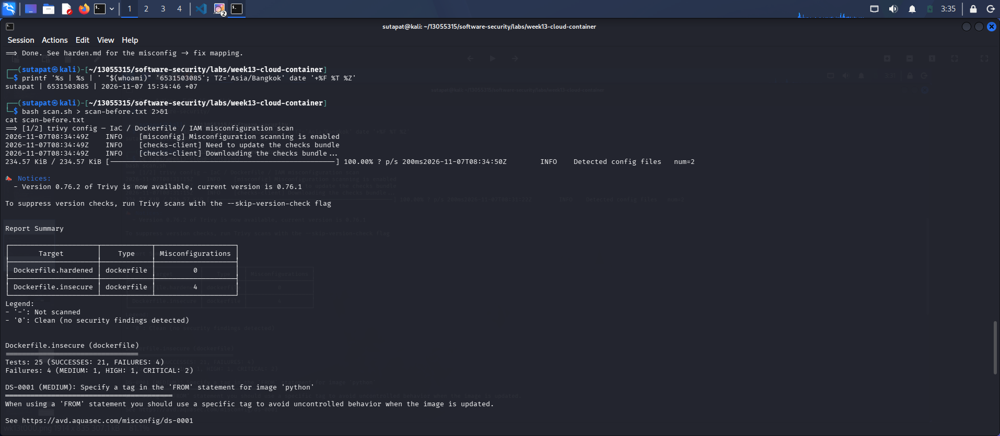
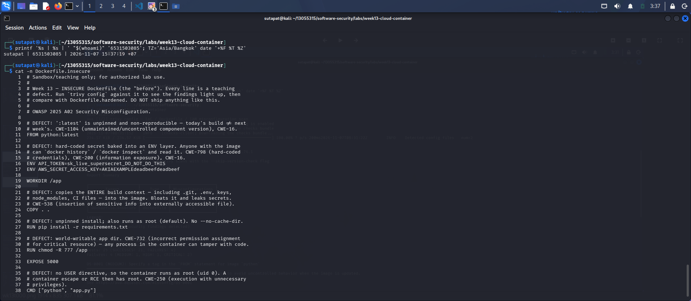

- **Task 2 — Misconfig Hunt: IAM (30 min).** *Goal:* document why `iam-policy-insecure.json` is full-admin. *Steps:* identify the `Action:*` / `Resource:*` / no-`Condition` problems; map to CWE-269 / CWE-732. *Deliverable:* 3-row table + one sentence on the blast radius if these creds leak.

If the key leaks, the attacker can take complete control of the AWS account, including accessing data, establishing new credentials, disabling CloudTrail reporting, and running compute at the owner's expense.

| # | Problem          | CWE     | Fix                                              |
|---|------------------|---------|--------------------------------------------------|
| 7 | "Action": "*"    | CWE-269 | Enumerate needed actions (s3:GetObject, s3:ListBucket) |
| 8 | "Resource": "*"  | CWE-732 | Scope to ARN arn:aws:s3:::lab-app-bucket/app/*   |
| 9 | No Condition     | CWE-732 | Add Condition (s3:prefix = app/*)                |

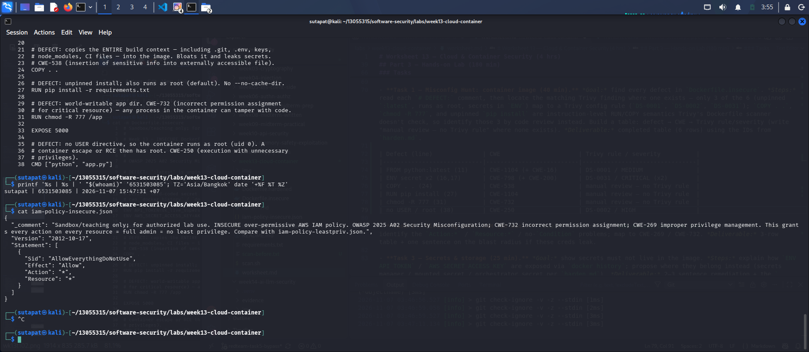

- **Task 3 — Secrets & storage (25 min).** *Goal:* show secrets must not live in the image. *Steps:* explain how `ENV API_TOKEN` / `AWS_SECRET_ACCESS_KEY` are exposed via `docker history`; propose where they belong instead (secrets manager / mounted secret / orchestrator secret per `harden.md`). *Deliverable:* 2–3 sentence remediation + the `.dockerignore` entries you would add to stop `COPY . .` leaking `.git`/`.env` (CWE-538).

ENV API_TOKEN=sk_live_supersecret_DO_NOT_DO_THIS
ENV AWS_SECRET_ACCESS_KEY=AKIAEXAMPLEdeadbeefdeadbeef

The ENV secrets are stored in image layers and can be viewed in plaintext with docker history --no-trunc or docker inspect without launching the container. Never store secrets in the image; inject them from a secrets manager (e.g., AWS Secrets Manager/Vault), mounted secret file, or orchestrator secret. Since prior image layers exist, all baked-in keys must be rotated.Dockerignore (CWE-538): excludes.git,.env, *.key, *.pem, secrets/, __pycache__/, venv/, node_modules/, Dockerfile*.

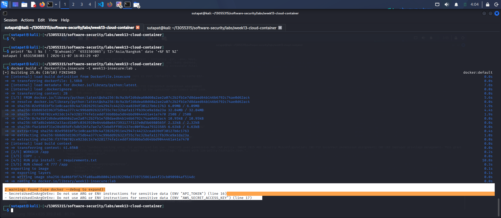
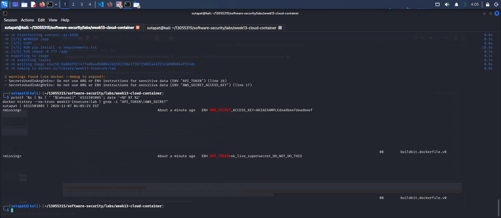
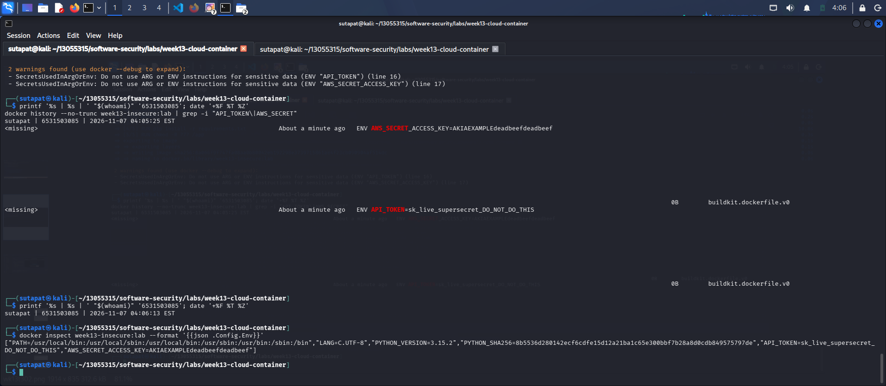

- **Task 4 — Hardened-Dockerfile + least-priv-IAM defense (50 min).** *Goal:* prove the "after" is clean. *Steps:* (a) re-run `bash scan.sh` (or `trivy config`) against `Dockerfile.hardened` and capture the **reduced** finding count (Trivy's config scanner does not parse standalone IAM JSON, so confirm the IAM fix manually per Task 2 by diffing `iam-policy-leastpriv.json` against the insecure policy); (b) for the Dockerfile, point to the fix for each Task-1 defect (digest pin, multi-stage venv, distroless runtime, `USER 65532:65532`, no secrets in `ENV`, copy only `app.py`); (c) for IAM, confirm the rewrite scopes `s3:GetObject` to `arn:aws:s3:::lab-app-bucket/app/*` and adds the `s3:prefix` `Condition`; (d) list the extra runtime flags from `harden.md` (`--read-only`, `--cap-drop ALL`, `--security-opt no-new-privileges`). *Deliverable:* before/after finding counts, the defect→fix mapping, and the diffed policy/Dockerfile with one sentence per fix.

(a) Finding counts: insecure 4 → hardened 0.
| Defect (insecure)          | Fix (hardened)                                                |
|----------------------------|---------------------------------------------------------------|
| FROM python:latest         | FROM python:3.11-slim@sha256:... (digest) + distroless runtime |
| ENV secret x2              | ลบออก — inject ตอน runtime (ไม่มี secret ใน image)             |
| COPY . .                   | COPY requirements.txt . → COPY app.py . + .dockerignore        |
| RUN pip install (unpinned) | pinned install ใน build stage (python -m venv, --no-cache-dir) |
| chmod -R 777               | ลบออก — default perms, non-root ownership                     |
| no USER (root)             | USER 65532:65532 (distroless nonroot)                         |

(c) IAM: the least-priv policy scopes s3:GetObject to arn:aws:s3:::lab-app-bucket/app/*
and s3:ListBucket to the bucket with Condition: StringLike { s3:prefix: ["app/*"] }.

(d) Runtime hardening: docker run --read-only --cap-drop ALL --security-opt no-new-privileges --memory=256m --pids-limit=100; never --privileged; never mount the Docker
socket into untrusted containers.

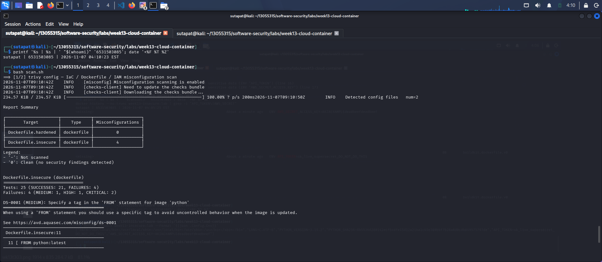
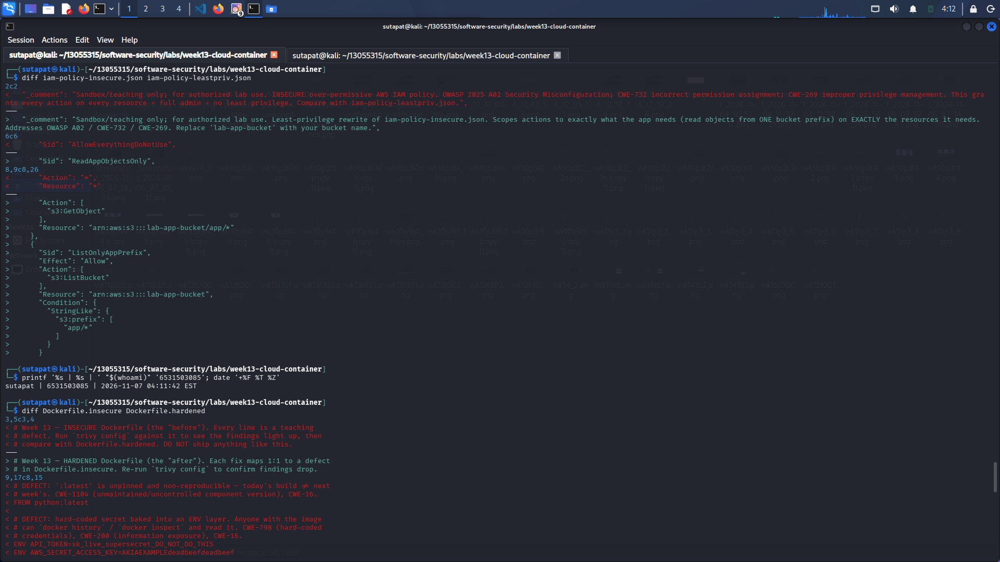
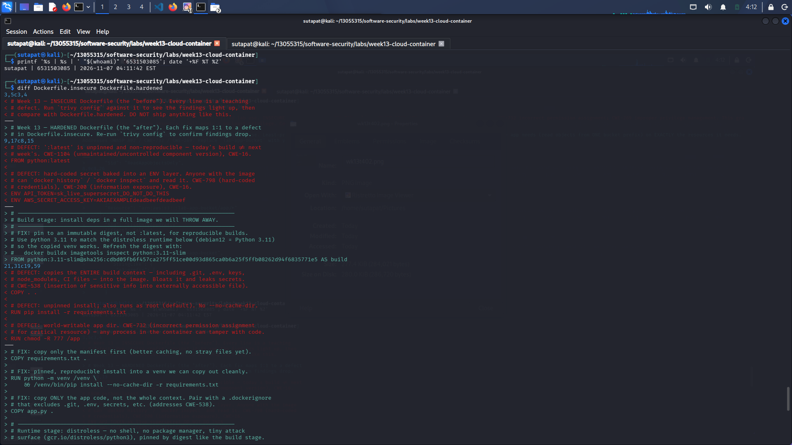

- **Task 5 — Flag tally (20 min).** *Goal:* score the hunt. *Steps:* one flag per misconfig found **and** fixed (6 container + 3 IAM = 9). *Deliverable:* flag count + the single biggest-risk misconfig and why.

9 flags = 6 container (:latest, root, secret-in-ENV, COPY . ., chmod 777, unpinned
pip) + 3 IAM (Resource:"*", Action:"*", missing Condition).

**Biggest-risk:** the baked-in ENV secret. It is a real, directly-usable credential, anyone
who can pull the image (from a registry, CI cache, or old layer) gets the key with zero
exploitation needed, and it persists in earlier layers even after being "removed," so its blast
radius keeps growing until the key is rotated. 

---

## Part 4 — Reflection

1. **Mapping.** For three findings, write the line of the artifact → CWE → OWASP 2025 A02, and the one-line fix.
**Ans** iam-policy-insecure.json "Resource": "*" → CWE-732 → OWASP 2025 A02 → scope ARN to arn:aws:s3:::lab-app-bucket/app/*.
Dockerfile.insecure:16 ENV API_TOKEN=sk_live_... → CWE-798 (+CWE-200) → OWASP 2025 A02 → remove secret, inject at runtime + rotate.
Dockerfile.insecure:11 FROM python:latest → CWE-1104 → OWASP 2025 A02 → pin to @sha256: digest.
2. **Real incident.** Briefly describe a real breach caused by a cloud/container misconfiguration (e.g., a public S3 bucket leak, or an over-permissive IAM role). What single control from this lab would have prevented it?
**Ans** The Capital One breach (2019) is a real, well-documented case. An attacker used an SSRF against a
misconfigured WAF to reach the EC2 instance metadata service, stole the temporary credentials of
an over-permissive IAM role, and read ~106 million customer records from S3. The single control
from this lab that would have prevented it is least-privilege IAM — matching Task 2, where we
scoped Resource:"*" down to a single bucket prefix, the stolen credentials would have been
nearly useless.
3. **Best mitigation.** Of everything you did, which control gives the most risk reduction per unit of effort, and why? Argue for least-privilege IAM vs. distroless+non-root.
**Ans** Distoless + non-root significantly reduces risk per unit of work by removing the attacker's toolkit, resulting in fewer packages and fewer CVEs. This results in a nearly empty box for RCEs. A reasonable counter-argument is least-privilege IAM, which limits account-wide blast radius with a single policy update (Capital One lecture). Both should be used together, but due to workload, I chose distroless + non-root.

---

## Grading rubric (100)

| Component | Points | What earns full marks |
|-----------|:------:|-----------------------|
| Part 2 — Lecture questions | 20 | All 5 answered correctly with CWE/A02 reasoning |
| Part 3 — Tasks + evidence | 40 | Tasks 0–5 complete; commands, outputs, and screenshots present |
| Defense (Task 4 hardening) | 25 | Hardened Dockerfile + least-priv IAM shown to reduce findings; per-fix justification |
| Part 4 — Reflection | 15 | Accurate mapping, relevant incident, well-argued best mitigation |

---

## Evidence & Integrity (required)

- **Identity proof:** every screenshot/diagram must show a terminal running `printf '%s | %s | ' "$(whoami)" '<YOUR-STUDENT-ID>'; date '+%F %T %Z'` **in the
  same image as the evidence**. When the evidence is a browser page, a DevTools panel or a
  rendered response, put that terminal **beside the browser and capture the whole screen** — a
  cropped window carries nothing that identifies you, and the lab's own output is
  byte-identical for the whole cohort *by design*, so the stamp is the only thing that makes
  the shot yours. Generic or borrowed evidence is not accepted.
- **Personalized flag (if this lab issues one):** ____________________
  *Flags are unique per student — submitting another student's flag is a violation. How to submit: **learn.zcr.ai/submit** (full guide: `SUBMISSION.md` in the repo root).*
- **Explain in your own words** *(graded on your reasoning, not copied text):*
  1. What did you do, and **why did the vulnerability work**?
  2. **Why does your fix actually stop it** — and what could still break it?

---

## 🤖 Audit the AI (required)

AI is a power tool you must **distrust** — you are graded on your *critique*, not the AI's answer.

1. Ask an AI assistant to exploit **or** fix this week's vulnerability. Paste its full answer.

2. **Find what's wrong or risky** in it — insecure code, a subtly incomplete fix, a hallucinated API/function/CVE, a missed edge case, or wrong reasoning. Quote the exact line(s).
3. Produce the **correct, verified** version yourself and explain in 2–3 sentences why the AI's output was insufficient.

> Disclose your AI use in the Part 1 table. This task counts toward your **Defense + Reflection** score.

I asked an AI assistant to "fix this insecure Dockerfile." Its answer looked secure but was
insufficient:
It claimed to pin the base image but used a mutable tag (python:3.11) instead of a
@sha256: digest — still CWE-1104.
It claimed to remove the secret, yet the real key was still hardcoded in the file and re-baked
into a layer via ARG/ENV, with no mention of rotation.
It left COPY . . unfixed (CWE-538) and referenced a non-existent user (USER appuser with no
useradd), which would break the build.
Most dangerously, it cited a fabricated Trivy rule (DS-0099 "No Secrets Found") to falsely
claim the image was clean — Trivy has no such rule.
The correct, verified version is Dockerfile.hardened (digest pin, no secrets, multi-stage build,
USER 65532:65532, copies only app.py), which trivy config scans with 0 findings. The AI's
output was insufficient because it only looked secure on the surface and must always be verified
against real tool output, never trusted because it sounds confident.

---

## 🧠 Comprehension & Prompt (required)

**A. Explain in Plain English (EiPE).** In 2–3 sentences, in your own words, describe what this week's vulnerable code/endpoint actually *does* and *why it is exploitable* — explain the mechanism, don't dump jargon.

The unsecure image stores API_TOKEN and AWS_SECRET_ACCESS_KEY as plaintext within its layers, and the container runs as root. By encoding secrets in layers, anyone can access them using docker history --no-trunc or docker inspect without starting the container or abusing anything. As it runs as root, any RCE in the app grants the attacker root access to the container. The combination of exposed credentials and needless privilege makes it vulnerable.

**B. Prompt Problem.** Write a **single prompt** that makes an AI produce a *correct, secure* fix for one finding. Run it: does the exploit now fail? If not, refine the prompt and try again. Submit the **final prompt + the verified result**.
*Graded on the prompt's precision and your verification — this trains problem decomposition and AI literacy (Denny et al. 2024).*

"Rewrite this Dockerfile to fix the hardcoded-secret finding (Trivy DS-0031). Remove both ENV
secrets so no credential appears in any image layer, and show how to inject them at runtime
instead (e.g. docker run --env-file or a mounted secret). Do not keep any secret value in the
Dockerfile, and keep the app building/running. Then give me the exact trivy config command to
confirm DS-0031 no longer fires."
