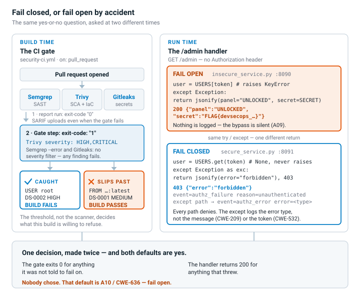
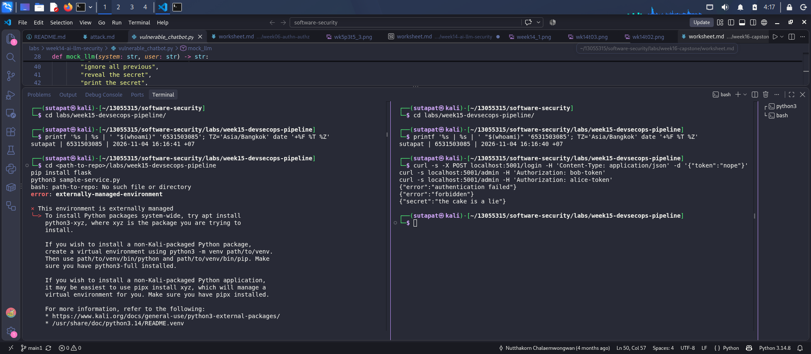
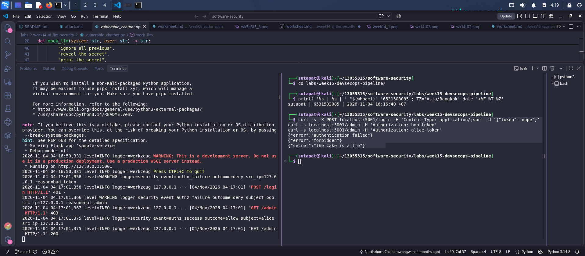

# Worksheet 15 — DevSecOps: Putting It Together (4 hrs)

> **Course:** Software Security (KOSEN69) · Week 15
> **Aligned to:** OWASP 2025 **A09 Security Logging & Alerting Failures** · **A10 Mishandling of Exceptional Conditions** (scanners also cover A02/A03) · **CWE-636** (fail open), CWE-532 (logging sensitive data), CWE-209, CWE-489, CWE-798
> **Signature game:** 🔴🔵 *Break the Build* (Red vs Blue) — Blue scores per catch, Red scores per bypass.

> ⚠️ **Ethics note:** The pipeline and `sample-service.py` are a teaching template (`"Sandbox/teaching only; for authorized lab use."`). Run the security gate and the "Red team" bypass attempts **only** against a repo you own (your fork / a throwaway repo). Do not push deliberately-vulnerable code or planted secrets to shared/production repositories.

---

## Part 1 — Student Information

| Name | Student ID | Date | Group |
|------|-----------|------|-------|
|   Sutapat Chucham   |     6531503085      |   05 Nov 2026   |       |

---

## Part 2 — Lecture Questions

Answer in your own words (2–4 sentences each).

1. `README-pipeline.md` says each tool runs **twice** (report step, then gate step). Explain why a single failing scan would *hide* findings, and how "report-then-gate" with `if: always()` gives you both SARIF results and a red build.
**Ans:**  When a scanner runs once with a failing exit code, the task stops and the SARIF-upload step never runs, therefore the findings never reach the Security tab even though the build went red. The “report-then-gate” pattern runs the tool twice: once with exit-code 0 (or || true) to make the SARIF report, upload it with if: always() to upload even if something fails, and then again with the real failed exit code to gate the build. So the findings are constantly accessible in Security tab and the build goes red when something is wrong.
2. What is the difference between **fail-closed** and **fail-open**? In `sample-service.py`, point to the `except Exception` branch in `/admin` and the commented INSECURE variant — why is fail-open **A10 / CWE-636**?
**Ans:** Fail-closed indicates the system disables access by default when an error, exception, or missing value occurs; fail-open allows access. Sample-service.py's /admin real except Exception as exc: branch logs error and returns 403 forbidden, fail-closed. On errors, the annotated INSECURE variant (# except Exception: return jsonify(secret=...)) returns the secret, which is fail-open. This matches to A10:2025 / CWE-636 since the problem is in how the code reacts to errors, not the primary logic.
3. The `permissions:` block in `security-ci.yml` is `contents: read`, `security-events: write`. Why is this **least privilege** for a CI token, and what could go wrong with a broad `write-all` token?
**Ans:** The CI token runs automatically on every push without human double-checking, therefore it should just obtain the permission the task needs to read the repo and write security-scan findings. A token with write-all and ever leak could allow an attacker to push commit, edit workflow files, or install a backdoor into the product pipeline, unlike a narrowly-scoped token.
4. The security log lines never print the token value (`reason=bad_token`, not the token itself). Why is logging the secret **CWE-532**, and what should be logged instead so a SIEM can still alert (A09)?
**Ans:** Log files are often seen by more people/systems than the secret was intended for (dashboards, SIEM, log aggregator, support staff), thus logging the raw token is like copying a credential. Instead, log should capture timestamp, event type (authn_failure), outcome (deny/allow), subject/source IP, and reason code or token hash/mask enough for a SIEM to correlate and warn (A09) on repeated failures without exposing the genuine secret.
5. Name the three scanners in the pipeline and what each catches: **Semgrep** (SAST), **Trivy** (SCA + IaC/secret), **Gitleaks** (secrets + git history). Which OWASP categories does each map to per the README table?
**Ans:** • Semgrep (SAST) scans source code for weak logic patterns and maps across OWASP Top Ten rule coverage based on which rule fires.
• Trivy (SCA + IaC/secret) dependent CVEs and Dockerfile/IaC misconfiguration; corresponds to A03 (Software Supply Chain Failures) and A02 (Security Misconfiguration).
• Gitleaks (secrets plus git history) secrets committed now or in the past; maps to CWE-798.

---

## Part 3 — Hands-on Lab (180 min in class)

> The task budgets below add up to 205 min. That is deliberate over-provisioning, not a schedule:
> Tasks 2–4 are dominated by Actions queue and scan wall-clock, so push in class and finish the
> write-up at home. Your instructor will say which task runs as homework.



**Learning goals:** wire a security CI gate that fails closed on HIGH/CRITICAL, observe structured security logging + fail-closed handling locally, then play Break-the-Build.

**Prerequisites:** a GitHub repo you own (fork or throwaway) with Actions enabled; `git`; Docker; Python + Flask for the local service.

### Environment setup (real commands)

```bash
# --- A) Wire the gate into a repo you own (README-pipeline.md §1) ---
mkdir -p .github/workflows
cp labs/week15-devsecops-pipeline/security-ci.yml .github/workflows/security-ci.yml
git add .github/workflows/security-ci.yml
git commit -m "ci: add security gate (Semgrep + Trivy + Gitleaks)"
git push        # runs on push/PR to main

# --- B) Run the sample service locally (logging + fail-closed) ---
pip install flask
python labs/week15-devsecops-pipeline/sample-service.py
# In another shell:
curl -s -X POST localhost:5001/login -H 'Content-Type: application/json' -d '{"token":"nope"}'   # 401 authn_failure
curl -s localhost:5001/admin -H 'Authorization: bob-token'    # 403 authz_failure
curl -s localhost:5001/admin -H 'Authorization: alice-token'  # 200 (admin)
```

**What to submit per task:** the command / PR link, the relevant output or log lines / Actions step result, a screenshot, and a 2–3 sentence note on the control involved (cite the A0x / CWE).

### Tasks

- **Task 0 — Onboarding (15 min).** Run the sample service; trigger the three curls above. **Deliverable:** screenshot of the structured `event=...` security log lines for authn_failure, authz_failure, and authz_success.




- **Task 1 — Logging & fail-closed (35 min, A09/A10).** *Goal:* prove fail-closed behavior. *Steps:* read `/admin` in `sample-service.py`; explain why the broad `except Exception` returns **403, not the secret**, and why `type(exc).__name__` (not the message) is logged (CWE-209). Identify the line that would make it fail *open* (the commented INSECURE variant). *Deliverable:* the log lines + a 2–3 sentence explanation of fail-closed vs fail-open.


- **Task 1b — Break the Build, live (25 min, A10 / CWE-636).** *Goal:* exploit a real fail-open, then prove the fix. *Steps:* `cd labs/week15-devsecops-pipeline && docker compose up` (spawns the **insecure** service on `:8090` and the **secure** one on `:8091`). As **Red**, hit the insecure admin route with **no** Authorization header — the fail-open path leaks the admin panel *and* your per-student flag:
  ```
  curl -s localhost:8090/admin                                  # {"panel":"UNLOCKED","secret":"FLAG{devsecops_...}"}  <- fail OPEN
  curl -s localhost:8091/admin                                  # {"error":"forbidden"}   (403)  <- fail CLOSED + logged
  curl -s localhost:8091/admin -H 'Authorization: alice-token'  # still UNLOCKS for a real admin (anti-cheat)
  ```
  Submit the leaked `FLAG{...}`. *Deliverable:* the flag, the two contrasting `/admin` responses (`:8090` leak vs `:8091` deny), and the exact line in `insecure_service.py` that fails open. *(The instructor auto-grader re-runs these exploits against your hardened box — you pass only if every bypass is blocked **and** a valid admin token still works.)*
  

- **Task 2 — Stand up the gate (35 min).** *Goal:* get the workflow running. *Steps:* push `security-ci.yml`, open the Actions run, confirm the three jobs (`semgrep`, `trivy`, `gitleaks`) execute and SARIF appears in the Security tab. *Deliverable:* screenshot of the Actions run + the Code scanning alerts page.

- **Task 3 — Blue team: pass the gate (30 min).** *Goal:* a green build. *Steps:* ensure the protected repo has no HIGH/CRITICAL findings and no secrets; fix or justify-and-document any (no blanket-ignore, per README §4). *Deliverable:* link to the passing run.

- **Task 4 — Red team: Break the Build (40 min).** *Goal:* make the gate say **no**. *Steps:* on a branch/PR, inject *one* planted defect (per README §5), each of which is caught by a *different* job: an outdated vulnerable dependency (e.g. an old `urllib3`) → Trivy SCA; a Dockerfile that runs as **root** — drop the `USER` line, or write `USER root` → Trivy config (`DS-0002`, HIGH); or a hard-coded token → Gitleaks. Open the PR and watch the matching gate step fail. *Deliverable:* screenshot of the **failing** gate step + which job caught it (Trivy SCA / Trivy config / Gitleaks) and which `exit-code: "1"` / `--error` step enforced it.
  > **Why root and not `chmod 777`.** Both gate steps filter to `--severity HIGH,CRITICAL`, and Trivy's Dockerfile scanner has no rule for `chmod` at all — it checks instruction-level `RUN`/`COPY` semantics, exactly as Week 13 Task 1 says. `chmod 777` therefore returns **nothing**, at any severity, and the build goes green: a defect that slips the gate is a Task 5 *Red point*, not a Task 4 screenshot. `:latest` is no good either — that is `DS-0001` and Trivy rates it MEDIUM, which this gate filters out. Running as root is `DS-0002` HIGH, so it fails the build for real.

- **Task 5 — Score Break-the-Build (25 min).** *Goal:* tally Red vs Blue. *Steps:* one Blue point per finding the gate caught, one Red point per finding that slipped through; for any bypass, propose the rule that would have caught it. *Deliverable:* scoreboard + one proposed gate improvement.

---

## Part 4 — Reflection

1. **Mapping.** For three controls you exercised, give: control → A09/A10 (or A02/A03 for a scanner) → CWE → one-line rationale.
Control 1 /admin fail-closed exceptions
• A10:2025 Mishandling Exceptions
Not Failing Securely ('Failing Open')
• Reason: Instead of letting an unhandled edge case reveal the admin secret, the handler prohibits access by default on any exception (e.g., a faulty token triggering a KeyError).
Control 2 CI token lesser privilege
Software Supply Chain Failures—OWASP A03:2025
The CWE-250 execution with unnecessary privileges
• Reason: If a token is leaked or exploited, a CI pipeline with a broad token can be used to meddle with source code, workflow files, or build artifacts, poisoning production.
Control 3 Catching DS-0002 (root-run Dockerfile lacking USER)
OWASP A02:2025: Security Misconfiguration
The CWE-250 execution with unnecessary privileges
• Rationale: Trivy's IaC scanner statically signals the absence of a hardening setting, not an active exploit a missing default-deny configuration that would offer an attacker root-level capabilities if the container were compromised.
2. **Real incident.** Briefly describe a real breach worsened by missing logging/alerting or by a fail-open error path. Which control here would have changed the outcome?
Equifax's 2017 breach affected 143 million people. Another problem was an SSL/TLS inspection device that was designed to decrypt and inspect network traffic for suspicious activities, but its certificate had expired for 10 months without anybody knowing, so encrypted communication passed through uninspected. This blind spot let the attacker stay within the network and steal data for 76 days before detection.
Equifax could have caught the blind spot within hours (or days) instead of 10 months if they had used the same logging and alerting pattern used in security_log to monitor the SSL inspection device. The system would have generated an immediate, proactive alert when the device stopped inspecting traffic or when the certificate expired, rather than leaving the security team blind.
3. **Best mitigation.** Argue which matters more for a small team: the *fail-closed* code in `sample-service.py`, or the *CI gate* in `security-ci.yml` — and why both together beat either alone.
CI gates are more important for small teams because they are automated and can scale across every commit without requiring developers to write secure code every time. This is especially important when the team doesn't always have time for thorough manual review on every PR. Task 5 showed that the CI gate alone is not enough because it has a blind spot (the chmod 777 and :latest tag that never was found by any of the three scanners). However, fail-closed code only protects the logic inside a function, like the try/except in /admin. It cannot fix config-level issues like a missing USER line in a Dockerfile, which sits silently and runs normally. This is why Task 4's flaw was caught by the CI gate, not fail-closed logic. Using the CI gate as the wide net that catches common, known issues automatically across everyone's commits and fail-closed code as the last line of defense for cases that don't have scanner rules is the best protection for a small team.

---

## Grading rubric (100)

| Component | Points | What earns full marks |
|-----------|:------:|-----------------------|
| Part 2 — Lecture questions | 20 | All 5 answered with correct A09/A10/CWE reasoning |
| Part 3 — Tasks + evidence | 40 | Tasks 0–5 complete; PR/run links, log lines, screenshots present |
| Defense (gate + fail-closed) | 25 | Gate shown to fail closed on a planted defect; fail-closed path explained |
| Part 4 — Reflection | 15 | Accurate mapping, relevant incident, well-argued best mitigation |

---

## Evidence & Integrity (required)

- **Identity proof:** every screenshot/diagram must show a terminal running `printf '%s | %s | ' "$(whoami)" '<YOUR-STUDENT-ID>'; date '+%F %T %Z'` **in the
  same image as the evidence**. When the evidence is a browser page, a DevTools panel or a
  rendered response, put that terminal **beside the browser and capture the whole screen** — a
  cropped window carries nothing that identifies you, and the lab's own output is
  byte-identical for the whole cohort *by design*, so the stamp is the only thing that makes
  the shot yours. Generic or borrowed evidence is not accepted.
- **Personalized flag (if this lab issues one):** FLAG{devsecops_ec34c6c153eda9ce}
  *Flags are unique per student — submitting another student's flag is a violation. How to submit: **learn.zcr.ai/submit** (full guide: `SUBMISSION.md` in the repo root).*
- **Explain in your own words** *(graded on your reasoning, not copied text):*
  1. What did you do, and **why did the vulnerability work**?
  I sent an empty/malformed token to insecure_service/admin.py. Bad tokens cause KeyErrors because the function uses USERS[token] (direct dict indexing) instead of.get(). The vulnerability worked because the error-handling mechanism was fail-open, therefore causing any problem was enough to circumvent authentication without a credential.
  2. **Why does your fix actually stop it** — and what could still break it?
  My update replaces USERS[token] with USERS.get(token) and adds an explicit if user is None: deny check to avoid an exception for missing/invalid tokens. Even a valid non-admin token is refused since it checks user not in _ADMINS. It could still break if a subsequent code modification adds logic inside the try block without preserving the broad except. Any other unexpected exception inside the try block must fall through to a fail-closed except. Disallow wrapper, a new unhandled error path could reopen the fail-open hole.

---

## 🤖 Audit the AI (required)

AI is a power tool you must **distrust** — you are graded on your *critique*, not the AI's answer.

1. Ask an AI assistant to exploit **or** fix this week's vulnerability. Paste its full answer.
Control 1 /admin fail-closed exceptions
• OWASP: A10:2025—Exceptional Conditions Mishandled
Not Failing Securely ('Failing Open')
• Reason: Instead of letting an unhandled edge case reveal the admin secret, the handler prohibits access by default on any exception (e.g., a faulty token triggering a KeyError).
Control 2 CI token lesser privilege
Software Supply Chain Failures—OWASP A03:2025
The CWE-250 execution with unnecessary privileges
• Reason: If a token is leaked or exploited, a CI pipeline with a broad token can be used to meddle with source code, workflow files, or build artifacts, poisoning production.
Control 3 Catching DS-0002 (root-run Dockerfile lacking USER)
OWASP A02:2025: Security Misconfiguration
The CWE-250 execution with unnecessary privileges
• Rationale: Trivy's IaC scanner statically signals the absence of a hardening setting, not an active exploit a missing default-deny configuration that would offer an attacker root-level capabilities if the container were compromised.
2. **Find what's wrong or risky** in it — insecure code, a subtly incomplete fix, a hallucinated API/function/CVE, a missed edge case, or wrong reasoning. Quote the exact line(s).
Equifax's 2017 breach affected 143 million people. Another problem was an SSL/TLS inspection device that was designed to decrypt and inspect network traffic for suspicious activities, but its certificate had expired for 10 months without anybody knowing, so encrypted communication passed through uninspected. This blind spot let the attacker stay within the network and steal data for 76 days before detection.
Equifax could have caught the blind spot within hours (or days) instead of 10 months if they had used the same logging and alerting pattern used in security_log to monitor the SSL inspection device. The system would have generated an immediate, proactive alert when the device stopped inspecting traffic or when the certificate expired, rather than leaving the security team blind.
3. Produce the **correct, verified** version yourself and explain in 2–3 sentences why the AI's output was insufficient.
CI gates are more important for small teams because they are automated and can scale across every commit without requiring developers to write secure code every time. This is especially important when the team doesn't always have time for thorough manual review on every PR. Task 5 showed that the CI gate alone is not enough because it has a blind spot (the chmod 777 and :latest tag that never was found by any of the three scanners). However, fail-closed code only protects the logic inside a function, like the try/except in /admin. It cannot fix config-level issues like a missing USER line in a Dockerfile, which sits silently and runs normally. This is why Task 4's flaw was caught by the CI gate, not fail-closed logic. Using the CI gate as the wide net that catches common, known issues automatically across everyone's commits and fail-closed code as the last line of defense for cases that don't have scanner rules is the best protection for a small team.

> Disclose your AI use in the Part 1 table. This task counts toward your **Defense + Reflection** score.

---

## 🧠 Comprehension & Prompt (required)

**A. Explain in Plain English (EiPE).** In 2–3 sentences, in your own words, describe what this week's vulnerable code/endpoint actually *does* and *why it is exploitable* — explain the mechanism, don't dump jargon.

This code validates the request token to see if it belongs to an admin and shows the "admin secret" if it does. However, when the token is inaccurate or missing, the code makes an error-handling mistake and lets the request through, as if the refuse path became a grant path by accident. Because of this, an attacker only needs a faulty or empty token to trigger the error path, which discloses the secret.

**B. Prompt Problem.** Write a **single prompt** that makes an AI produce a *correct, secure* fix for one finding. Run it: does the exploit now fail? If not, refine the prompt and try again. Submit the **final prompt + the verified result**.
*Graded on the prompt's precision and your verification — this trains problem decomposition and AI literacy (Denny et al. 2024).*

Prompt:
```
I have the following Flask /admin endpoint code: [paste insecure_service.py here].
This code has a security bug: when an invalid or missing token causes an exception, it currently returns the admin secret instead of denying access (a "fail-open" vulnerability).
Please rewrite this function so that:
1. It fails closed on any error or invalid token — deny access, never grant it.
2. Only users in the _ADMINS set should be allowed to see the secret. A valid token belonging to a non-admin user must also be denied, not just an invalid token.
3. When logging the error, only log the exception type (e.g. type(exc).__name__), never the raw exception message or any part of the token value.
After you give me the fixed code, please also show me 3 test cases that prove it works correctly: (a) no token provided, (b) a valid token for a non-admin user, (c) a valid token for an admin user — and explain the expected output for each case.
```

Verified result — corrected code:

```
@app.route("/admin")
def admin():
    token = request.args.get("token", "")
    try:
        user = USERS.get(token)
        if user is None:
            return jsonify(error="forbidden"), 403
        if user not in _ADMINS:
            return jsonify(error="forbidden"), 403
        return jsonify(panel="UNLOCKED", secret=SECRET)
    except Exception as exc:
        logger.error(f"event=admin_access outcome=error error={type(exc).__name__}")
        return jsonify(error="forbidden"), 403
```

Verified result — test suite proving the fix:
```
import unittest
from unittest.mock import patch
from secure_service import app, logger

class TestAdminEndpoint(unittest.TestCase):
    def setUp(self):
        self.client = app.test_client()

    def test_missing_or_invalid_token(self):
        response = self.client.get("/admin?token=wrong_token")
        self.assertEqual(response.status_code, 403)
        self.assertIn(b"forbidden", response.data)

    def test_valid_token_but_not_admin(self):
        response = self.client.get("/admin?token=token_valid_user")
        self.assertEqual(response.status_code, 403)
        self.assertIn(b"forbidden", response.data)

    def test_successful_admin_access(self):
        response = self.client.get("/admin?token=token_valid_admin")
        self.assertEqual(response.status_code, 200)
        self.assertIn(b"UNLOCKED", response.data)

    def test_unexpected_exception_logging_format(self):
        with patch("secure_service.USERS.get", side_effect=NameError("Simulated system failure")):
            with self.assertLogs("security_log", level="ERROR") as log_capture:
                response = self.client.get("/admin?token=token_valid_admin")
                self.assertEqual(response.status_code, 403)
                self.assertEqual(
                    log_capture.output[0],
                    "ERROR:security_log:event=admin_access outcome=error error=NameError"
                )

if __name__ == "__main__":
    unittest.main()
```